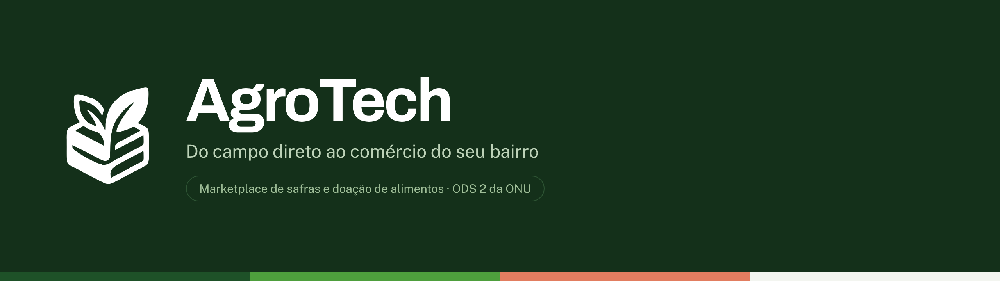

# AgroTech

**A AgroTech liga quem planta a mercadinhos e ONGs aqui perto.** Sem atravessador, com frete curto e com destino certo para a colheita que hoje se perde no galpão.

Uma iniciativa da **Brasil A&T**, alinhada ao **ODS 2 da ONU** — Fome Zero e Agricultura Sustentável.

---

## O problema

O pequeno produtor colhe, mas nem sempre consegue escoar. Quando o preço cai ou o frete custa mais que a carga, a safra fica no galpão. Do outro lado da mesma estrada, mercadinhos compram caro de distribuidores grandes e instituições sociais não encontram alimento fresco.

| Dado | Fonte |
| --- | --- |
| 77% dos estabelecimentos agropecuários do Brasil são de agricultura familiar | IBGE · Censo Agropecuário 2017 |
| 40% a 50% das frutas e hortaliças se perdem antes de chegar à mesa | FAO · perdas e desperdício de alimentos |

A AgroTech não tenta reinventar o agronegócio. Ela resolve o encontro: mostra, em um raio de poucos quilômetros, quem tem lote disponível hoje e quem precisa dele — para comprar ou para receber como doação.

## Como funciona

1. **O produtor publica o lote.** Produto, quantidade, prazo de retirada e o destino: venda para comércios ou doação para instituições.
2. **Quem está por perto encontra.** O catálogo mostra primeiro o que está mais perto e com prazo mais curto. Doações ficam visíveis apenas para instituições verificadas.
3. **A retirada é combinada direto.** As duas partes marcam dia e hora no sítio e acertam o pagamento entre si.

## Para quem é

- **Pequeno produtor rural** — anuncia a colheita em dois minutos e combina a retirada direto com quem vai buscar, sem atravessador mandando no preço.
- **Comércio de bairro** — mercadinho, quitanda e feirante compram direto do sítio mais perto, com produto colhido na semana.
- **ONG e projeto social** — vê no mapa as doações aqui perto e marca a retirada, pagando só o transporte.

## No que a gente acredita

- **Só fazemos o que resolve problema de verdade.** Cada coisa nova precisa resolver algo real: o frete que não compensa, a caixa de verdura que ia estragar, a prateleira vazia da ONG.
- **Quem precisa mais vem primeiro.** O pequeno agricultor e as ONGs vêm na frente nas decisões — até na ordem do catálogo.
- **Simples de usar no celular.** Botão grande, letra que dá para ler e palavra fácil, para quem tem pouca familiaridade com aplicativo.
- **Todo mundo tem que ganhar.** Se um lado sai perdendo, para nós não está certo.

## Nosso compromisso com o ODS 2

| Meta | O que fazemos |
| --- | --- |
| **2.1** — comida boa na mesa de quem precisa | O que sobra na lavoura vai para as ONGs daqui perto em vez de estragar. De graça para as duas pontas. |
| **2.3** — mais dinheiro no bolso de quem planta | Sem atravessador no meio, quem plantou põe o próprio preço e fica com o dinheiro da venda. |

## Como a AgroTech se sustenta

- **Doação sem taxa** — nenhuma cobrança sobre lotes doados, em etapa nenhuma.
- **Venda sem comissão** — quem planta põe o preço e fica com todo o dinheiro da venda.
- **Anúncio em destaque** — só paga quem quiser aparecer no topo do catálogo. É daí que vem a receita.

## As telas

| # | Tela | O que faz |
| --- | --- | --- |
| 1 | Início | Apresenta a proposta, os números do problema, os três públicos e os lotes com retirada próxima. |
| 2 | Catálogo de safras | Lista os lotes com filtro por tipo (todas, venda, doação) e por distância. Doações aparecem primeiro. |
| 3 | Área do produtor | Formulário de publicação do lote, com escolha entre venda e doação e prévia do anúncio. |
| 4 | Entrar | Acesso à conta, com validação nativa de HTML5. |
| 5 | Sobre nós | Missão, visão, como funciona, valores, compromisso com o ODS 2 e perguntas frequentes. |
| 6 | Ficha do lote | Página do anúncio: fotos, descrição, dados do produtor e local aproximado de retirada. |
| 7 | Fale conosco | Formulário de contato com validação, anexo opcional e consentimento de uso dos dados. |

Cada tela tem a versão de celular correspondente. O projeto é **mobile first**: o desenho começou em 390 px.

## Tecnologia

Front-end puro, sem back-end nesta etapa:

- HTML5 semântico, com validação nativa nos formulários
- CSS (Tailwind ou Bootstrap via CDN, conforme a tela)
- JavaScript puro para filtros, abas, carrossel e acordeão
- Ícones [Lucide](https://lucide.dev) em SVG inline

## Rodando o projeto

```bash
git clone https://github.com/Kaique-Parente/agrotech.git
cd agrotech
# abra o index.html no navegador, ou sirva a pasta:
python3 -m http.server 8000
```

## Identidade visual

O símbolo é um caixote de feira visto de frente, com duas folhas saindo de dentro. Funciona em uma cor só, imprime em caixa e carimbo e continua legível a 18 px.

| Cor | Hex | Uso |
| --- | --- | --- |
| Verde campo | `#1E5128` | Áreas grandes, botões, marca |
| Verde broto | `#4E9F3D` | Indicadores e detalhes finos |
| Laranja colheita | `#E27D60` | Sistema de doação e urgência |
| Fundo | `#F3F5F0` | Fundo das páginas |
| Texto | `#1B2A1E` | Texto corrido |

Tipografia: **Archivo** (títulos e números) e **Public Sans** (textos e formulários).

Arquivos da marca em [`docs/`](docs): SVG verde, branco e preto, além do ícone de aplicativo.

## Status

Em desenvolvimento. As telas estão desenhadas e navegáveis; o back-end e a integração de mapas entram nas etapas seguintes.

## Equipe

[NOMES DA EQUIPE]

---

© 2026 Brasil A&T · Todos os direitos reservados
